# TAKALEX MVP TECHNICAL PLAYBOOK

This guide is divided into 4 one-week phases (sprints), each with clear goals, deliverables, and daily priorities:



# Stack Decision Rationale (Could be slightly adjusted on need basis)

*We will use React Native + Expo* over Flutter for this project because we are more likely to find JS/TS talent in Nairobi, and Expo's managed workflow dramatically cuts DevOps overhead in a sprint. We get OTA updates (critical for post-launch patches without app store delays) and EAS Build handles binary generation.

*Supabase* over Firebase because PostgreSQL's Row Level Security handles our RBAC requirements natively at the database level — a Collector literally cannot query another group's records even if they bypass the app. Firebase requires us to implement that logic ourselves in every query.

*Mapbox* over Google Maps because we can style tiles to match Chemolex's brand colors at no extra API cost, and it performs better offline with tile caching. 

# PHASE 1: FOUNDATION
The goal of this phase is to have a working skeleton that every future feature attaches to. We do not build features yet.

**Step 1: Repository & Environment Setup**
Initialize the monorepo

takalex/
  apps/
    mobile/          ← React Native (Expo)
  packages/
    shared/          ← types, constants, API helpers
  supabase/
    migrations/      ← all DB schema SQL here
    seed.sql
  .github/
    workflows/       ← CI pipeline

Run *npx create-expo-app mobile --template blank-typescript* inside *apps/*. Install core dependencies immediately:
   *@supabase/supabase-js, react-native-maps, @rnmapbox/maps, expo-sqlite, expo-location, zustand (state management), react-hook-form, zod (validation).*


**Step 2: Backend ( Supabase Project & Database Schema).**

# Create the Supabase project. 
Write the first migration in *supabase/migrations/001_initial_schema.sql.* 
The core schema for MVP: 

# -- Enums
CREATE TYPE user_role AS ENUM ('collector', 'admin', 'recycler');
CREATE TYPE material_type AS ENUM ('PET', 'HDPE', 'LDPE', 'MIXED');
CREATE TYPE collection_status AS ENUM ('pending', 'approved', 'paid');

# -- Sites table (the 6 Nairobi locations)
CREATE TABLE sites (
  id UUID PRIMARY KEY DEFAULT gen_random_uuid(),
  name TEXT NOT NULL,
  location GEOGRAPHY(POINT, 4326) NOT NULL,
  active BOOLEAN DEFAULT true,
  created_at TIMESTAMPTZ DEFAULT NOW()
);

# -- User profiles (extends Supabase auth.users)
CREATE TABLE profiles (
  id UUID PRIMARY KEY REFERENCES auth.users(id),
  full_name TEXT,
  phone TEXT,
  role user_role NOT NULL DEFAULT 'collector',
  site_id UUID REFERENCES sites(id),
  group_id UUID, -- FK added after groups table
  is_active BOOLEAN DEFAULT true,
  created_at TIMESTAMPTZ DEFAULT NOW()
);

# -- SME Groups
CREATE TABLE sme_groups (
  id UUID PRIMARY KEY DEFAULT gen_random_uuid(),
  name TEXT NOT NULL,
  site_id UUID REFERENCES sites(id),
  leader_id UUID REFERENCES profiles(id),
  member_count INT DEFAULT 0,
  created_at TIMESTAMPTZ DEFAULT NOW()
);

# -- Waste Collection Logs
CREATE TABLE collection_logs (
  id UUID PRIMARY KEY DEFAULT gen_random_uuid(),
  collector_id UUID REFERENCES profiles(id),
  group_id UUID REFERENCES sme_groups(id),
  site_id UUID REFERENCES sites(id),
  material material_type NOT NULL,
  weight_kg DECIMAL(10,2) NOT NULL,
  status collection_status DEFAULT 'pending',
  price_per_kg DECIMAL(8,2),
  total_payout DECIMAL(10,2) GENERATED ALWAYS AS (weight_kg * price_per_kg) STORED,
  logged_at TIMESTAMPTZ DEFAULT NOW(),
  synced_at TIMESTAMPTZ -- null means created offline
);

Then write RLS policies immediately.

# -- Collectors only see their own logs
ALTER TABLE collection_logs ENABLE ROW LEVEL SECURITY;
CREATE POLICY "collector_own_logs" ON collection_logs
  FOR SELECT USING (
    collector_id = auth.uid() OR
    EXISTS (SELECT 1 FROM profiles WHERE id = auth.uid() AND role = 'admin')
  );


**Step 3: Auth Flow**
Build the AUTH screens: Login, Register ( with role selection hidden; Admin creates Collector a/c's via invite). Use Supabase Auth with email/password and *phone OTP as fallback*. ( This is important for the informal waste pickers). Store the session in a Zustand store with persistence via *expo-secure-store*

// stores/authStore.ts
interface AuthState {
  user: User | null;
  profile: Profile | null;
  role: UserRole | null;
  setSession: (user: User, profile: Profile) => void;
  signOut: () => void;
}
```
After login, immediately fetch the user's `profile` row to get their `role` and `site_id`. This drives all navigation and RLS automatically.


**Step 4 — Navigation Architecture**

Use Expo Router (file-based routing). Structure navigation with role-based layouts:
```
app/
  (auth)/
    login.tsx
    register.tsx
  (collector)/
    _layout.tsx    ← Tab navigator
    index.tsx      ← Dashboard
    log.tsx        ← Log waste
    history.tsx    ← My collections
  (admin)/
    _layout.tsx
    index.tsx      ← Overview
    sites.tsx      ← Site management
    groups.tsx     ← SME groups


In the root *_layout.tsx*, redirect based on role:
const { role } = useAuthStore();
if (!role) return <Redirect href="/(auth)/login" />;
if (role === 'admin') return <Redirect href="/(admin)" />;
return <Redirect href="/(collector)" />;


**Step 5: CI/CD Pipeline**
Set up Github Actions. Create .github/workflows/ci.yml:

name: CI
on: [push, pull_request]
jobs:
  lint-test:
    runs-on: ubuntu-latest
    steps:
      - uses: actions/checkout@v4
      - uses: actions/setup-node@v4
        with: { node-version: '20' }
      - run: npm ci
      - run: npm run lint
      - run: npm test -- --passWithNoTests
  
  eas-preview:
    if: github.ref == 'refs/heads/main'
    runs-on: ubuntu-latest
    steps:
      - uses: actions/checkout@v4
      - uses: expo/expo-github-action@v8
        with:
          eas-version: latest
          token: ${{ secrets.EXPO_TOKEN }}
      - run: eas build --profile preview --platform android --non-interactive

At this point, also configure Sentry:
*npx expo install @sentry/react-native* and initialize *app/_layout.tsx*. This catches crashes in production from Day 1 of beta.


# PHASE 2: CORE DASHBOARDS.
This is the MVP delivery phase: two dashboards. Build one screen at a time, test it, and commit.

1. **Collector Dashboard: Key Screens**
The home screen shows three stat cards:
*Today's Weight, this month's weight, pending payout and a quick-log button.*

Pull data from Supabase in real-time using *supabase.channel()*:
useEffect(() => {
  const channel = supabase
    .channel('my-logs')
    .on('postgres_changes', {
      event: 'INSERT',
      schema: 'public',
      table: 'collection_logs',
      filter: `collector_id=eq.${userId}`
    }, (payload) => {
      // update local state
    })
    .subscribe();
  return () => supabase.removeChannel(channel);
}, [userId]);

Te waste logging form is the most critical screen in the app. We will use *react-hook-form* + *zod* validation.
* Fields: material type for segmented control, weight(numerical input with decimal), date(defaults today), optional notes.
* On submit, we will write to the local SQLite queue first, then attempt Supabase sync. If offline, show a "Saved locally: will sync when online" badge.


**Offline-First Pattern for field collectors**

// offlineQueue.ts
export async function logWasteOfflineFirst(log: WasteLogInput) {
  // 1. Always write to SQLite immediately
  await db.runAsync(
    'INSERT INTO pending_logs VALUES (?, ?, ?, ?, ?)',
    [log.id, log.material, log.weight_kg, log.logged_at, 'pending']
  );
  
  // 2. Try to sync immediately
  const isOnline = await NetInfo.fetch();
  if (isOnline.isConnected) {
    await syncPendingLogs();
  }
  // 3. Register background sync for when connectivity returns
  await BackgroundFetch.registerTaskAsync('SYNC_LOGS');
}


2. **Admin Dashboard: Key Screens.**
The admin home screen has a summary strip:
* Total sites: 10, 
* Active Collectors: 248, 
* Total Waste This Month: X kg, 
* Pending Payouts: KES X.
* List of all 10 sites with their current inventory levels. Pull this from an aggregated Postgres view:

CREATE VIEW site_summary AS
SELECT
  s.id,
  s.name,
  COUNT(DISTINCT p.id) AS active_collectors,
  COALESCE(SUM(cl.weight_kg) FILTER (WHERE cl.logged_at > NOW() - INTERVAL '30 days'), 0) AS monthly_kg,
  COALESCE(SUM(cl.total_payout) FILTER (WHERE cl.status = 'pending'), 0) AS pending_payout_kes
FROM sites s
LEFT JOIN profiles p ON p.site_id = s.id AND p.is_active = true
LEFT JOIN collection_logs cl ON cl.site_id = s.id
GROUP BY s.id, s.name;

The Approve Payouts flow is straightforward: Admin sees a list of *pending* logs grouped by collector, taps to batch-approve, which runs a Supabase Edge Function that updates statuses and triggers a payout record.


**Map & Analytics**

*Interactive Map*
Initialize Mapbox in *(admin)/sites.tsx*. The sites are seeded in *supabase/seed.sql* with exact GPS coordinates for Kariadudud, Ngomongo, Kariobangi, Babadogo, Mathare, and Njiru. Then render them as custom markers with a color indicating capacity status: *(green=under 50%)*, *(amber=50-80%)*, *(red=over 80%)*.

On marker tap, render a bottom sheet *( use @gorhom/bottom-sheet)* showing the site card: name, active groups count, current inventory, and a "View Records" button that pushes to the detailed site screen.

const siteMarkerColor = (fillPercent: number) => {
  if (fillPercent < 50) return '#1D9E75';  // teal
  if (fillPercent < 80) return '#BA7517';  // amber
  return '#A32D2D';                         // red
};


**Analytics Charts**
Use *react-native-chart-kit* or *victory-native* for charts. For MVP, deliver three charts on the Admin dashboard: a bar chart (for weekly waste volume per site), a pie chart(for material type breakdown: PET vs HDPE vs LDPE), and a line chart (monthly trend over 3 months). All three are computed server-side via Postgres views to minimize client-side processing.

The impact metrics should strip:
* Jobs created: 248.
* Women empowered: 156.
* Youth engaged: 92.
* Rivers restored: 3
* Water quality: 45%.

Should be a horizontally scrollable card row at the top of the Admin analytics screen. These numbers are stored in a *kpi_overrrides* table that Admins can update manually for now. 
# Real-time computation is a key Phase 2 Feature.

**SME Group Management**
Build the group management screen for Admin:
* List all groups.
* View a group's member's and their individual collection history.
* Add/remove members.

This should be a standard CRUD against the *sme_groups* and *profiles* tables. 

Use optimistic UI updates: 
# Update local state first, then sync in the background, rollback on error.

**Hardening & Deployment**
*Testing*
Write test at three levels:
1. Unit tests with Jest for all utility functions:
* Weight calculations, payout computations, offline queue logic.
2. Integration tests with Supabase's local emulator *supabase start* for all RLS policies; test that a Collector with *group_id = X* cannot read logs from *group_id=Y*. 
3. E2E tests with Detox for the three critical user flows:
* Collector logs waste ==> Admin sees it ==> Admin approves payout.

# Run the test suite against a seed database with all the sites, 10 SME groups, and 50 test users scross roles.


**Performance & Edge Cases**
* Profile the app with Flipper and the React Native Performance Monitor.

# Watch for the following specific issues:

*FlatList re-renders on the Admin site list*. Use *React.memo* and *keyExtractor*, Mapbox performance with all markers and clustering enabled, and the SQLite sync queue under poor network conditions. *Test with Network Link Conditioner on iOS Simulator set to "Very Bad Network.*

# Handle the following edge cases explicitly:
*Zero collections on a new site (empty state screens, not blank screens), duplicate log submissions when offline queue syncs twice, and session expiry mid-use (auto-refresh token, fallback to re-login).


**Staging Deployment**
Create 3 Supabase environments:
* *dev* (local), *staging*, and *production*.

Run the full migration set against staging. We will need to configure EAS Build profiles:

// eas.json
{
  "build": {
    "development": { "developmentClient": true, "distribution": "internal" },
    "staging": { "distribution": "internal", "env": { "APP_ENV": "staging" } },
    "production": { "distribution": "store" }
  }
}

Generate the staging APK with *eas build --profile staging --platform android*. 

# Distribute to Chemolex stakeholders via Expo's internal distribution link for UAT (User Acceptance Testing) to get real field feedback on Android usage before production.


**PRODUCTION LAUNCH**
Run the production migration:
*supabase db push --db-url $PROD_URL*. 

Seed the sites and create the first Admin account. Enable Supabase's built-in database backup for daily snapshots.

# Submit the Android APK to the Play Store internal testing track, but do not go public yet.

# Configure Sentry alerts for crash rate >2% and API error rate >5%. Set up a Supabase *pg_cron* job to run the analytics aggregation views nightly so dashboards load instantly.
